# Notebook AWS Migration --- DynamoDB Data Model & Offline Sync Specification
**Document status:** Revised architecture specification — audit-informed; proposed for review
**Phase:** 0.2.4 — Step 3.3
**Scope:** Current-state mapping, DynamoDB logical data model, offline mutation contract, concurrency, idempotency, migration behavior, failure handling, and acceptance criteria
**Implementation status:** Design only. No AWS resources or application code are implemented or changed by this document.
**Evidence basis:** Read-only repository audit of the current Notebook frontend, Firebase configuration, Firestore/Storage rules, and deployment workflows. Findings below describe inspected code; browser behavior that has not been tested is explicitly marked for verification.
---

## Architecture overview



## 1. Design goals

1. Preserve Notebook's offline-first user experience during the
Firebase-to-AWS migration.
2. Keep each user's data isolated.
3. Prevent stale offline edits from silently overwriting newer server
data.
4. Make mutation retries safe when a response is lost.
5. Keep the initial architecture small: one DynamoDB application table,
no GSI unless a measured access pattern requires one.
6. Make data changes, version-history creation, and idempotency
outcomes atomic where they must succeed or fail together.
7. Keep attachment binaries in S3; store only metadata and object keys
in DynamoDB.
8. Make failure states explicit and testable.

## 1.1 Verified Firebase current state and migration implications
The repository audit observed the following current behavior. These are migration inputs, not defects that must all be copied unchanged into AWS.

- Authentication uses Firebase email/password and Google sign-in. Firebase UID scopes profile and data paths. AWS target: Cognito authentication; the backend derives the owner identity from validated token claims.
- Notes and folders use Firestore-generated document IDs. The note model includes `title`, `content`, `category`, `folderId`, `reminder`, attachment metadata, `lang`, pin state, and timestamps. Folder records include `name`, `parentId`, and `createdAt`; folder updates are not currently implemented.
- Note search, category/folder filtering, pin sorting, and updated-time sorting are performed client-side after the current collection listener loads notes. The inspected path does not show pagination.
- Current note deletion is a physical delete. Undo recreates the captured data at the old ID. Folder deletion does not check references. These behaviors are not equivalent to the proposed AWS tombstone and guarded-folder policies.
- Version history is a subcollection with content-only snapshots and a server timestamp. The audit could not verify that each saved snapshot is the pre-update state; restore places content into the editor and requires a later save.
- Firestore persistent local cache is enabled, but the inspected frontend does not contain an application-owned IndexedDB mutation outbox, operation IDs, or a visible local-vs-cloud sync state. The editor waits for Firestore write promises before acknowledging success; offline UX must be browser-tested.
- Firebase Storage holds attachment binaries. Current note/account deletion does not explicitly clean up all Storage objects or version subcollections. AWS cleanup must cover DynamoDB and S3.
- A service-worker file exists, but no registration call was found in the inspected tracked frontend. Do not assume the service worker currently supplies offline shell caching.
- The current GitHub Actions workflows deploy Firebase Hosting on pushes to `master` and create pull-request preview channels. AWS deployment must be introduced as a separate workflow and must not accidentally replace the Firebase production workflow during migration.

### 1.2 Migration principles

1. Preserve the existing Firebase production application until the AWS implementation has passed acceptance tests and a deliberate cutover plan is approved.
2. Preserve existing Firestore note and folder document IDs where practical during data import so references remain stable. New AWS-created entities use client-generated stable IDs.
3. Map every known current field explicitly. Unknown or unsupported fields must be reported during migration rather than silently discarded.
4. Treat legacy version history as legacy content history, not as verified full-note snapshots or trustworthy sequential numeric versions.
5. Decide explicitly whether existing Firebase attachments and legacy history will be copied, retained read-only in Firebase, or excluded. Do not silently drop them.
6. Verify offline behavior in a browser before finalizing the AWS acceptance baseline; code inspection alone does not establish the exact user-visible acknowledgment behavior.

### 1.3 Current-to-target field mapping

| Current Firebase entity/field | AWS target mapping | Migration note |
|---|---|---|
| Firebase Auth UID | Cognito subject/owner identity | Establish an explicit identity mapping; do not assume Firebase UID equals Cognito `sub`. |
| User profile document and settings | `PROFILE` item under `PK=USER#<aws-owner-id>` | Inventory individual settings before migration. |
| Firestore note document ID | `noteId` and `SK=NOTE#<noteId>` | Preserve the original ID where practical; validate uniqueness within the user's partition. |
| `title`, `content` | Same logical attributes | Validate supported types and payload-size limits. |
| `category`, `folderId`, pin state | `category`, `folderId`, `pinned` | Preserve values; validate folder references and normalize pin state to a boolean. |
| `reminder` | `reminder` | Current value is a string; document and validate its accepted format before adding scheduling semantics. |
| `lang` | `lang` | Preserve the existing language field. |
| `createdAt`, `updatedAt` | `createdAt`, `updatedAt` | Keep source timestamps as migration provenance where useful; future AWS writes use server-managed timestamps. |
| Attachment metadata (`URL`, name, size, type, ID, Storage path) | Attachment metadata with S3 object key and lifecycle state | A Firebase download URL is not an S3 key. Copy and verify the object, then rewrite metadata. Never log signed URLs or tokens. |
| Folder document ID, `name`, `parentId`, `createdAt` | `folderId`, `name`, `parentId`, timestamps, `version` | Preserve `parentId` even though the current UI does not appear to create nested folders. Decide whether nested-folder behavior is supported in the AWS UI. |
| Legacy version subcollection content and timestamp | Version item marked `legacy=true` with source timestamp/provenance | Do not fabricate a title, full-note state, or reliable numeric version order that the source does not contain. |

The exact profile settings and any additional fields must be confirmed by a source-field inventory before migration scripts are approved. This table is the known mapping from the audit, not a claim that every source field has already been enumerated.

## 2. DynamoDB table and key conventions
Initial logical table name: `notebook-data` (the deployed physical name
should be environment-specific and managed by Terraform).

Primary key:
- Partition key: `PK` (String)
- Sort key: `SK` (String)

The table is designed around user-scoped access. The backend derives the
user ID from the validated Cognito identity and constructs `PK`; it must
never trust a client-supplied user ID. The `<uid>` placeholder in this
document means the stable AWS owner identifier selected by the identity
mapping, not necessarily the original Firebase UID.

| Entity | PK | SK |
|---|---|---|
| User profile | `USER#<uid>` | `PROFILE` |
| Note | `USER#<uid>` | `NOTE#<noteId>` |
| Folder | `USER#<uid>` | `FOLDER#<folderId>` |
| Note version snapshot | `USER#<uid>` | `VERSION#<noteId>#<20-digit-version>` |
| Idempotency/operation record | `USER#<uid>` | `OP#<operationId>` |

Use stable IDs generated before the first network request for notes,
folders, and operations. This lets an offline-created resource retain
the same identity after synchronization.

### 2.1 Note item
Representative logical attributes:

| Attribute | Meaning |
|---|---|
| `PK`, `SK` | Primary key |
| `entityType` | `NOTE` |
| `noteId` | Stable note ID |
| `title`, `content` | Note fields |
| `category`, `folderId`, `pinned` | Organization fields |
| `version` | Integer concurrency version |
| `createdAt`, `updatedAt` | Server-managed ISO-8601 timestamps |
| `deleted`, `deletedAt` | Tombstone state, when deleted |
| `attachments` | Attachment metadata references, if retained on the note |

The backend, not the browser clock, owns authoritative `createdAt` and
`updatedAt` values. Client timestamps may be retained as diagnostic
metadata but must not determine conflict precedence.

### 2.2 Folder item
Representative attributes: `PK`, `SK`, `entityType=FOLDER`, `folderId`,
`name`, `createdAt`, `updatedAt`, `version`, and `state` (`ACTIVE` or
`DELETING`). A completed deletion may use a tombstone or physical removal
according to the retention policy selected before implementation.

The guarded folder-deletion protocol in Section 8 uses `state` to prevent
new note references while existing references are checked.

### 2.3 Version snapshot item
Representative attributes: `PK`, `SK`, `entityType=VERSION`, `noteId`,
`version` (Number), `title`, `content`, `createdAt`, and the note metadata
captured by the snapshot convention below. The numeric version attribute
remains numeric; only its sort-key representation is zero-padded.

Version snapshots are written by the backend. The browser must not be
trusted to author authoritative history records. The version component in
the sort key is represented as a 20-digit, zero-padded decimal string so
lexicographic sort-key order matches numeric version order. The item also
stores the unpadded numeric `version` attribute for concurrency and client
logic. Version values must fit the selected 20-digit representation.

### 2.4 Operation record
Representative attributes: `PK`, `SK`, `entityType=OPERATION`,
`operationId`, `requestHash`, `status`, `resultSummary`, `createdAt`,
and `expiresAt` if a retention/TTL policy is approved.

The operation record supports idempotency. The same `operationId` with a
different request body must be rejected; it must not be treated as a
retry of the original request.

Retention must be longer than the supported client retry/offline window.
Do not enable TTL until the retry horizon, restore expectations, and
operational recovery requirements have been decided. Expiring a record
too early can permit an old retry to be applied again.

## 3. Access patterns

| ID | Access pattern | Initial operation |
|---|---|---|
| AP-01 | Load a user's notes | Query `PK = USER#<uid>` and `begins_with(SK, NOTE#)` |
| AP-02 | Load a user's folders | Query `PK = USER#<uid>` and `begins_with(SK, FOLDER#)` |
| AP-03 | Get one note | `GetItem` using exact PK and SK |
| AP-04 | Create a note | Conditional `PutItem` |
| AP-05 | Update a note | Conditional `UpdateItem` |
| AP-06 | Delete a note | Conditional `UpdateItem` to tombstone |
| AP-07 | Restore a note | Conditional `UpdateItem` from tombstone state |
| AP-08 | Pin/unpin | Conditional `UpdateItem` setting explicit `pinned` value |
| AP-09 | Move note | Conditional `UpdateItem` setting `folderId` |
| AP-10 | Filter by folder | Client-side filtering after loading notes |
| AP-11 | Filter by category | Client-side filtering after loading notes |
| AP-12 | Search note text | Client-side search after loading notes |
| AP-13 | Load versions for a note | Query with `begins_with(SK, VERSION#<noteId>#)`; results sort by zero-padded version key |
| AP-14 | Create a version snapshot | `PutItem` in the same transaction as the corresponding mutation |
| AP-15 | Get a specific version | `GetItem` using exact PK and SK |
| AP-16 | Read attachment metadata | Read metadata associated with the note |
| AP-17 | Upload attachment | Request presigned URL; upload directly to S3 |
| AP-18 | Delete attachment | Authorized backend operation plus S3 deletion workflow |
| AP-19 | Read/update user profile | `GetItem` / conditional `UpdateItem` |
| AP-20 | Account deletion | Controlled cleanup workflow across DynamoDB and S3 |
| AP-21 | Persist offline mutation | IndexedDB transaction on the client |
| AP-22 | Synchronize mutation | Authenticated API request with idempotency and conditional writes |

No GSI or OpenSearch index is proposed initially. Reassess only if product requirements or measured performance show that client-side filtering/search or the current key model is insufficient.

### 3.1 Pagination contract
DynamoDB `Query` responses are paginated. The API must not assume one query returns every note, folder, or version.

- Use a configurable, bounded page size and return an opaque continuation token derived from `LastEvaluatedKey`; do not ask the browser to construct DynamoDB keys.
- Validate that a continuation token belongs to the authenticated user's query and expected entity prefix, or encode/sign the token server-side.
- The client may load successive pages and sort/filter locally. If the product UI claims to search all notes, it must either load all pages into its local cache first or clearly indicate the current loaded scope.
- Initial target: support loading all pages for the user's notes/folders into the local cache, with bounded response sizes and progress/error handling. Do not introduce a GSI solely for client-side sorting.
- Test empty pages with a continuation key, interrupted pagination, duplicate page requests, and resuming after a transient error. Do not assume a single paginated sequence is a transactionally consistent snapshot while concurrent writes occur.
- Revisit server-side search or additional indexes only when measured user volume or latency justifies them.

## 4. Offline client data and queue
IndexedDB is the durable local store for cached entities and pending
mutations. The existing service worker/PWA cache is not a substitute for
a transactional data store.

Suggested logical stores: `notes`, `folders`, `versions`, `syncQueue`, and `syncMetadata` (for cursor/state only if later required).

A mutation should be persisted to IndexedDB before the UI claims that
the change is safely queued. The UI may update optimistically but must
distinguish **Saved on this device** from **Synced with cloud**.

### 4.1 Mutation envelope

```
{
  "operationId": "client-generated-uuid",
  "operationType": "UPDATE",
  "entityType": "NOTE",
  "entityId": "note-123",
  "baseVersion": 4,
  "payload": {
    "title": "Updated meeting notes",
    "content": "Revised content"
  },
  "clientCreatedAt": "2026-10-21T08:00:00Z"
}
```
This is a conceptual envelope. The final API schema must validate
allowed fields per operation and reject unknown or immutable fields. Do
not accept `PK`, `SK`, `userId`, authoritative timestamps, `version`, or
deletion state from the client as trusted write values.

Suggested local-only queue metadata includes `status`, `attempts`,
`lastAttemptAt`, `lastErrorCode`, `claimantId`, and `leaseExpiresAt`. Keep
transport/claim metadata separate from the business payload.

### 4.2 Supported operations

- `CREATE`
- `UPDATE`
- `DELETE`
- `MOVE`
- `PIN`
- `RESTORE` (restoring a deleted note; historical-snapshot restore loads content into the editor and is saved as a normal `UPDATE`)

`PIN` must send an explicit desired state (`pinned: true` or
`pinned: false`), not a toggle command. Retries of a toggle can invert a
state that was already applied.

Create operations use stable client-generated entity IDs and conditional
creation so a retry cannot create a second resource. For updates to one
entity, process dependent mutations in order. Independent entities may
be synchronized independently.

## 5. API contract
Initial endpoint: `POST /sync`, protected by a Cognito JWT authorizer.

The API should initially accept one mutation per request. A bounded
batch API can be considered later if measured usage justifies it.

### 5.1 Authentication and authorization

- Validate the access token using the configured API Gateway JWT
authorizer.
- Derive the owner UID from trusted token claims (`sub` or the
explicitly configured claim).
- Construct all user-scoped keys server-side.
- Check ownership and resource state on every operation.
- Never authorize using a `userId` in the request body.
- Validate payload size, types, required fields, and allowed
operation/entity combinations.

### 5.2 Success response
Return a structured response containing:

- `operationId`
- `outcome` (`APPLIED` or `ALREADY_APPLIED`)
- `entityType` and `entityId`
- authoritative `version` and server timestamps where relevant
- authoritative resource state, or a minimal result sufficient for the client to reconcile local state

Do not acknowledge/remove a queue entry until the client has received a
valid outcome and committed the acknowledgement/local reconciliation to
IndexedDB. If the browser crashes before that local commit, it retries
the same operation ID.

### 5.3 Error response
Use machine-readable error codes, for example:

- `INVALID_MUTATION`
- `UNAUTHENTICATED`
- `NOT_AUTHORIZED`
- `RESOURCE_NOT_FOUND`
- `VERSION_CONFLICT`
- `RESOURCE_DELETED`
- `IDEMPOTENCY_KEY_REUSED`
- `RATE_LIMITED`
- `TEMPORARY_FAILURE`

Suggested HTTP mapping:

- `200`: operation already applied and recorded, or a successful non-create mutation
- `201`: resource created
- `400`: invalid request
- `401`: missing, invalid, or expired authentication
- `403`: authenticated caller lacks permission
- `404`: missing or inaccessible resource, without leaking another user's data
- `409`: version conflict or incompatible resource state
- `429`: throttled
- `5xx`: temporary server failure

The exact mapping should be kept consistent in implementation and tests.
Do not return sensitive note contents in logs or error messages.

## 6. Idempotency and atomicity
A request can be applied by the backend while its response is lost.
Therefore every retry must use the same `operationId`.

For each request:

1. Validate the mutation and derive the owner identity from the authenticated token.
2. Canonicalize the validated semantic mutation fields and compute a request hash. The canonicalization algorithm and included fields must be fixed in the API schema before implementation; transport-only fields and untrusted client timestamps must not change the semantic hash unless explicitly part of the mutation contract.
3. Strongly consistently read the operation record for the authenticated user and `operationId`.
4. If a completed record exists with the same hash, return its stored result as `ALREADY_APPLIED`. If the ID exists with a different hash, return `IDEMPOTENCY_KEY_REUSED`.
5. If no record exists, attempt one atomic DynamoDB transaction. It must apply the resource mutation, write the required snapshot, and conditionally create the operation record with `attribute_not_exists` for that operation key.
6. If a concurrent duplicate loses the transaction race, strongly consistently reread the operation record. If its hash matches, return the recorded result; if it differs, return `IDEMPOTENCY_KEY_REUSED`. If no operation record exists, classify the transaction cancellation using the resource's current state and return the appropriate conflict, condition, or transient error.

The transaction is the concurrency guarantee; the initial operation-record read is an optimization. The operation record's conditional creation and the resource's version/state condition must be part of the same transaction. A duplicate retry must never create a second resource mutation or snapshot.

Do not write the operation record separately after the resource update.
That can leave a successful mutation with no idempotency record and
allow duplicate side effects on retry.

DynamoDB transactions have item-count and size limits; the
implementation must keep each mutation transaction within those limits
and handle transaction cancellation by classifying the cause (duplicate,
version conflict, conditional failure, or transient error).

## 7. Optimistic concurrency and version history
Each mutable resource has a server-managed integer `version`.

- A new note starts at version `1`.
- An update must provide the version the client edited as
`baseVersion`.
- The update succeeds only if the current server version equals
`baseVersion` and the resource is not deleted.
- On success, increment the version atomically and set `updatedAt` on
the server.
- For note creation, write the version `1` snapshot and operation record in the same transaction as the new note.
- For content updates that create history, write the resulting snapshot and new note state in one DynamoDB transaction. Metadata-only updates increment the note version but do not create a content snapshot by default, as specified in Section 7.1.
- Use the deterministic version key `VERSION#<noteId>#<20-digit-version>` with the zero-padding convention defined in Section 2.3.
- The snapshot represents the resulting state for its version, not the pre-update state.
- If the conditional update fails because the current version differs, return `409 VERSION_CONFLICT` with the current version and, only after ownership is established, the latest resource state required by the client.

### 7.1 Snapshot semantics and legacy history

**Target convention:** a version snapshot represents the complete note state captured at the successful content-edit operation that produced that version. A snapshot is immutable after creation. Its `version` attribute is numeric, while its sort-key version component is zero-padded to 20 digits (for example, version 5 is `VERSION#<noteId>#00000000000000000005`).
History queries must return the snapshot items that actually exist, ordered by their version sort keys. The client must not generate missing history entries or interpret gaps in snapshot versions as missing or corrupted data.

- A newly created note starts at concurrency version `1` and creates its initial snapshot at version `1`. The create transaction includes the note item, initial snapshot, and operation record.
- Content edits create a snapshot containing the resulting note state, including `title`, `content`, `category`, `folderId`, `reminder`, `lang`, `pinned`, and the attachment metadata references that are part of the note at that time. Do not copy binary attachment contents into DynamoDB snapshots.
- Metadata-only operations (pin, move, category/folder changes, and reminder changes) increment the note's concurrency `version` but do not create a content-history snapshot by default. Consequently, not every numeric note version has a corresponding snapshot. The UI and API must not assume a one-to-one relationship between note versions and snapshot items.
- Restoring a historical snapshot never changes or deletes that snapshot and never moves the note's version backwards. The client loads the selected snapshot into the editor; saving it is a new update based on the latest current note version and creates a new snapshot under the newly incremented version. Current metadata that is not explicitly restored should be preserved according to the restore UX contract. This is distinct from restoring a deleted note, which clears its tombstone through a conditional operation and increments the current version.
- The note update, required snapshot, and idempotency result must commit atomically.
- The current Firebase history contains content-only snapshots and does not establish reliable pre-update or full-note semantics. Imported records must be labelled `legacy=true`, retain available source timestamps and source identifiers, and must not be represented as verified full-note snapshots or assigned fabricated version numbers.
- Before migration, choose one explicit policy: (A) import legacy content entries as read-only legacy history; (B) retain them in Firebase read-only and expose a migration notice; or (C) exclude them only after a documented product decision. Recommended default: import them as read-only legacy history when their source records can be enumerated safely.
- The migration acceptance test must verify that a new AWS snapshot can be loaded into an editor and saved as a new version, without mutating the historical snapshot itself.

### Conflict resolution
For note content conflicts: 1. Preserve the local draft. 2.
Fetch/reconcile the latest authorized server version. 3. Offer the user
explicit choices: keep server version; apply local content as a new
update based on the latest version after confirmation; or save the local
draft as a separate note. 4. Never automatically overwrite newer content
using client timestamps. 5. Do not automatically merge Markdown/text in
the initial release.

A conflict pauses dependent operations for that note until resolved.
Independent notes can continue syncing.

## 8. Delete, restore, and folder behavior

### Note deletion
Use a tombstone (`deleted=true`, `deletedAt`, incremented `version`)
rather than immediate physical removal. A stale update must not recreate
a tombstoned note. Restore is an explicit conditional operation that
checks the current version and deletion state.

Tombstone retention and permanent cleanup must be specified before
implementation. Cleanup must account for supported offline/retry windows
and recovery expectations.

### Folder deletion

Reject deletion while notes reference the folder. A preliminary query alone is not sufficient because a note could be moved into the folder between the check and deletion. Use a guarded protocol:

1. Conditionally transition the folder from `ACTIVE` to `DELETING` using its expected version.
2. Every note-create or note-move operation that assigns a note to a folder must include a DynamoDB `ConditionCheck` for that folder's `state = ACTIVE` in the same `TransactWriteItems` transaction as the note mutation. A separate preliminary read is insufficient. The folder check and note mutation must be atomic with respect to one another.
3. After the folder enters `DELETING`, query all pages of the user's notes and check for references. Use a strongly consistent query where supported and do not rely on a partial page.
4. If references remain, conditionally return the folder to `ACTIVE` and reject deletion with a conflict that requires the user to move or otherwise handle those notes.
5. If no references remain, complete the folder deletion/tombstone using a conditional write. Folder updates and deletes require concurrency checks.

This protocol prevents a concurrent note assignment from racing past the deletion check.

### Attachment deletion

DynamoDB metadata and S3 object deletion are not one atomic transaction. Treat deletion as a durable workflow: authorize the operation, mark the attachment `DELETE_PENDING` and detach it from the active note state as appropriate, perform S3 deletion, then record `DELETED` or `DELETE_FAILED`. Failed deletion must remain observable and retryable. S3 deletion should be safe to repeat. Do not assume a DynamoDB transaction can include an S3 API call.

## 9. Retry and recovery policy

- Persist mutations in IndexedDB before treating them as queued.
- Retry network errors, throttling, and transient `5xx` errors using
exponential backoff with jitter and a maximum retry delay.
- Set a bounded automatic retry policy, but do not discard an
operation when the retry limit is reached. Mark it as needing
attention and preserve the payload.
- Do not blindly retry `400`, `403`, or `409`; classify and surface
them appropriately.
- On `401`, pause protected sync until the session is refreshed or the
user signs in again.
- Reuse the same operation ID on every retry.
- Use connectivity events as a hint, not the only trigger; also
attempt sync on app launch/resume and when the queue is non-empty.
- Recover pending operations from IndexedDB after refresh/restart.
- If local browser storage is cleared or evicted, unsynchronized
local-only changes may be lost; do not promise otherwise.
- Process dependent operations for the same resource in order. Avoid duplicate concurrent processing of one queue entry with a local lease/claim or equivalent coordination.
- Coordinate queue claims across browser tabs using an IndexedDB transaction. A claim should record a claimant identifier and lease expiry; a tab may renew its lease while processing. If a tab crashes, another tab may reclaim the entry after expiry. Lease duration, renewal cadence, and stale-claim recovery behavior are implementation gates. The same `operationId` must be retained when a claim is recovered.

## 10. Attachment scope
Attachment binaries are not placed in the initial note mutation queue.
The browser requests an upload URL from an authenticated endpoint, then
uploads directly to S3. The backend authorizes the requested
note/attachment and constrains object keys to the authenticated user's
namespace.

Only mark an attachment as attached to a note after the upload succeeds, the backend verifies the object (for example, with an object metadata check), and the metadata commit is confirmed. Suggested lifecycle states are `PENDING_UPLOAD`, `ACTIVE`, `DELETE_PENDING`, `DELETE_FAILED`, and `DELETED`. Failed or abandoned uploads require cleanup; abandoned multipart uploads must also be covered where multipart upload is used. The exact cleanup mechanism and age threshold are implementation gates. The existing Firebase UI uploads attachments directly to Storage and limits each file to 1 MB. The audit indicates attachment upload requires connectivity; verify this in browser testing. Offline binary upload is out of scope for the initial sync engine. AWS attachment size/type limits must be decided separately; do not assume the existing 1 MB limit is automatically the target limit.

### 10.1 Account deletion and cross-store cleanup

Account deletion spans Cognito, DynamoDB, and S3 and cannot be treated as one atomic transaction. Implement a controlled, observable workflow:

1. Authenticate and re-confirm the request; prevent new writes for the account once deletion is accepted.
2. Create a durable deletion-job control record outside the user's ordinary `PK=USER#<uid>` partition. To preserve the initial one-table design, use a reserved key namespace such as `PK=ACCOUNT_DELETE#<uid>`, `SK=STATE`, with the job ID and workflow status stored as attributes. The ordinary user-data deletion sweep must not delete this control record. Every mutation transaction must include a DynamoDB `ConditionCheck` against the account-deletion control record. Mutations must be rejected when the deletion job is in a blocking state: `REQUESTED`, `PENDING`, `IN_PROGRESS`, or `RETRY_REQUIRED`. A missing control record permits normal mutations. A retained `COMPLETED` record must not block reads of deletion status, although the deleted Cognito identity must no longer be able to authenticate. If cancellation is supported, define its authorization and transition rules before implementation. The condition check must be part of the same transaction as the resource mutation; a preliminary read alone is insufficient. The control-record status transitions and mutation checks must be designed so a deletion request cannot race with a concurrent write.
3. Enumerate and delete user-owned DynamoDB items in bounded batches, including notes, folders, profiles, version items, and operation records. Respect DynamoDB limits and retry unprocessed items.
4. Enumerate and delete user-owned S3 objects, including attachments and abandoned multipart uploads where applicable.
5. Record progress and failures without logging note contents or credentials; make the workflow safely retryable.
6. Delete/disable the Cognito identity only when the chosen recovery and audit policy permits it. If the identity is deleted earlier, ensure cleanup can continue using a trusted service role and durable job state that does not depend on the user's token or identity record.
7. Verify no user-owned DynamoDB items or S3 objects remain and emit an operational result. Mark the deletion job complete only after verification. Define partial-failure handling, retry exhaustion, and operator escalation before implementation.
8. Retain or expire the deletion-job control record according to a separately defined audit/retention policy; do not remove it as part of ordinary user-data cleanup.

The exact orchestration service is intentionally not fixed in this data-model document. Choose the simplest reliable mechanism during implementation planning; do not promise synchronous completion if cleanup can exceed request time limits.

## 11. Observability and privacy
Log structured diagnostic fields such as operation ID, entity type,
outcome, retry count, error category, and request correlation ID. Avoid
logging note titles, note content, attachment contents, access tokens,
or unnecessary personal data.

Useful metrics include:

- Mutation success/failure counts by error category.
- Conflict rate.
- Retry count and queue age.
- API latency and throttling.
- Lambda errors/throttles.
- DynamoDB conditional-check failures and throttling.
- Age/count of operations needing user attention.
- Count and age of pending/failed attachment cleanup jobs.
- Count and age of incomplete account-deletion jobs.

Alarm thresholds should be set when expected baseline traffic and
operational goals are established.

## 12. Acceptance tests
The specification is not ready for implementation sign-off until tests
cover:

1. Offline create persists locally and syncs after reconnect.
2. Offline update persists through refresh/restart.
3. Same operation ID retried after a lost response does not duplicate
the mutation or version snapshot.
4. Same operation ID with a different request hash is rejected.
5. Two devices update the same base version; one succeeds and the stale
one receives a conflict.
6. A conflict preserves the local draft and pauses dependent operations
for that entity.
7. A stale update cannot resurrect a tombstoned note.
8. Restore is allowed only from a valid deleted state and expected
version.
9. Folder deletion with referenced notes is rejected.
10. Expired authentication pauses sync and does not leak data.
11. A user cannot access or mutate another user's resource by altering
IDs or payload fields.
12. A transient `5xx` or `429` is retried with the same operation ID.
13. A permanent validation/authorization error is not retried
indefinitely.
14. A browser restart recovers the persisted queue.
15. One conflicted note does not block unrelated notes.
16. Version snapshots and note updates commit atomically.
17. Failed S3 deletion is observable and can be reconciled.
18. Queue acknowledgement is committed locally only after a valid server
result.
19. API validation rejects client attempts to set server-owned fields.
20. Logs and error responses do not expose note content, tokens, or cross-user data.
21. Migration preserves the known note fields: title, content, category, folderId, reminder, lang, pin state, timestamps, and attachment metadata.
22. Migration preserves folder IDs, names, parentId, and available timestamps; dangling references are reported rather than silently ignored.
23. Legacy content-only history is clearly marked and is never presented as a verified full-note snapshot.
24. An attachment migration copies the binary to S3, verifies the object, and updates metadata only after successful verification; failures are resumable.
25. Notes, folders, and version queries handle multiple pages and continuation tokens without silently omitting records.
26. Search/filter UX does not claim to cover unloaded pages when only part of the user's data is cached.
27. AWS deployment workflow changes do not disrupt the existing Firebase production deployment before cutover approval.
28. Account deletion safely retries after partial DynamoDB or S3 cleanup failure and verifies cross-store cleanup.
29. Browser tests document current Firebase offline create/update, refresh/restart, reconnect, and editor acknowledgment behavior as the baseline for the AWS implementation.
30. Service-worker registration is confirmed as intended or documented as absent; no acceptance criterion assumes service-worker caching until verified.
31. Folder deletion cannot race with a concurrent note create/move that assigns a note to the folder; the guarded folder state prevents new references while deletion is checked.
32. A crashed browser tab cannot permanently lock a queued operation; another tab can reclaim it after lease expiry and retry with the same operation ID.
33. Account deletion can resume after the Cognito identity and ordinary user-partition DynamoDB records have been deleted, using the durable deletion-job control record and trusted service role.

## 13. Decisions still required before coding

The following remain implementation gates and must be recorded before the relevant implementation work begins:

- Exact retention period for operation records and note tombstones; TTL remains disabled until this is decided.
- Final conflict response payload and client UX wording.
- Exact retry count/backoff limits and the queue's `needs-attention` state.
- Attachment deletion reconciliation mechanism, abandoned-upload cleanup policy, and attachment size/type limits.
- Final IndexedDB schema, schema-upgrade strategy, and cross-tab lease timing/recovery behavior.
- Account-deletion workflow/orchestration, control-record retention, and partial-failure/operator-escalation handling.
- Source-to-Cognito user identity mapping.
- Final policy for legacy Firebase version history and attachment migration.
- Exact profile settings/field inventory.
- Whether nested folders are supported in the AWS UI.
- Browser-tested Firebase offline acknowledgment baseline.
- Whether any access pattern emerging from implementation justifies a GSI.
- Final page size, continuation-token format, and client loading behavior.
- Canonical request-hash algorithm and exact semantic fields included in the hash.
- Final API error/response schema and version-conflict payload.
- Confirmation that the selected 20-digit version-key representation is acceptable for the application's expected lifetime.

These gates do not prevent architecture review, but they must be resolved before the corresponding behavior is implemented or migration scripts are approved.

## 14. Definition of done for this specification

- Key schema and access patterns reviewed.
- Server-owned fields and authorization rules explicit.
- Idempotency transaction and duplicate-request race handled, including strongly consistent reread behavior.
- Version checks and version snapshots atomic; key ordering and snapshot semantics are consistent.
- Conflict, deletion, restore, attachment lifecycle, account cleanup, and retry behavior explicit.
- Current-to-target field mapping reviewed, including profile, reminders, language, folders, history, and attachments.
- Pagination and continuation-token behavior specified.
- Folder deletion and cross-tab queue coordination are race-safe by design.
- Legacy history and attachment migration policies selected or explicitly tracked as pre-migration gates.
- Acceptance tests mapped to implementation tasks.
- Remaining decisions resolved or tracked as explicit implementation gates.
- No claim of implementation until code and tests exist.
**Next phase after review:** Phase 0.2.5 — Terraform Foundation. Begin only after the specification review and implementation gates are accepted. The Firebase production app remains active; this specification does not provision resources or perform cutover.

## 15. Revision note — audit-informed update
This revision incorporates the read-only source audit findings and the final architecture-review corrections: Firebase-managed persistence is distinguished from the planned IndexedDB outbox; current fields and migration concerns are documented; version-key ordering, snapshot semantics, idempotency races, folder deletion, cross-tab queue coordination, attachment lifecycle, and durable account-deletion cleanup are clarified; pagination and acceptance coverage are expanded. It does not assert that the proposed AWS architecture or behaviors have been implemented.
$
